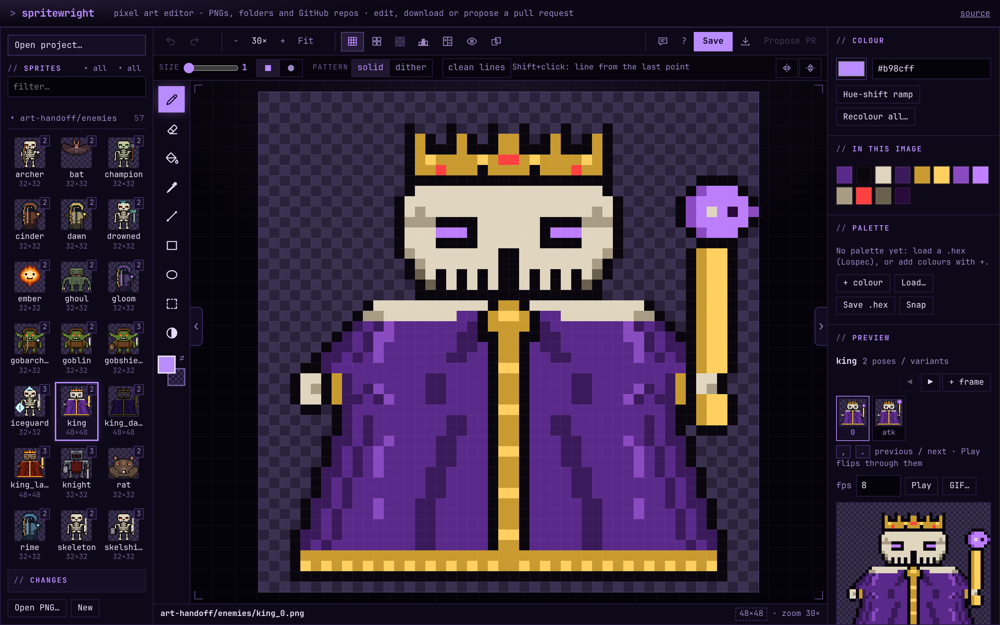
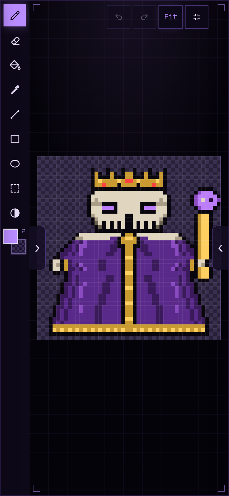

# spritewright

A pixel art editor that works **by itself in a browser** or **as a dependency inside a game repository**. No runtime dependencies, no build step.

**Tools.** Brush sizes 1-16 (square or round tip) for the pencil, eraser, shade and the line and outline shapes; pencil with a "clean lines" pixel-perfect mode, eraser, fill (connected area or every pixel of that colour), line, rectangle and ellipse (outline or filled, Shift for squares, circles and 45° lines), a checkerboard **dither** pattern for the pencil, fills and shapes, a **dither gradient** (`J`: drag from the primary colour to the secondary, filling the selection or the area you start in with an ordered dither), a **shade** brush that steps colours lighter or darker with hue shifting (or through your palette), colour picker (or Alt+click), **select and move** with copy, cut, paste (including images copied from other apps), nudge, flip, rotate and delete, mirror drawing, a **tile** preview for seamless textures that lets you draw across the edges, **onion skin** for sprite-sheet animation, and one-click outlines.
**Tools.** Brush sizes 1-16 (square or round tip) for the pencil, eraser, shade and the line and outline shapes; pencil with a "clean lines" pixel-perfect mode, eraser, fill (connected area or every pixel of that colour), line, rectangle and ellipse (outline or filled, Shift for squares, circles and 45° lines), a checkerboard **dither** pattern for the pencil, fills and shapes, a **shade** brush that steps colours lighter or darker with hue shifting (or through your palette), colour picker (or Alt+click), **select and move** (rectangle, **lasso** `Q` or **magic wand** `W` by connected area or by colour; Shift adds, Alt subtracts) with copy, cut, paste (including images copied from other apps), nudge, flip, rotate and delete, mirror drawing, a **tile** preview for seamless textures that lets you draw across the edges, **onion skin** for sprite-sheet animation, and one-click outlines.

**Colour.** Primary and secondary colours (right click paints the secondary one, which starts out clear so right click erases; X swaps), hue-shifted 5-colour ramps you can add to the palette, recolour a colour everywhere, project palettes (.hex), palettes from **Lospec** by name or link (`endesga-32`), snap to palette.

Also undo/redo, flip/rotate/shift/resize, **rotate by any angle** with RotSprite (lines stay clean instead of scattering), **smooth ×2** upscaling with Scale2x, a sprite-sheet animation preview, PNG import and export with nearest-neighbour upscaling, mouse, touch and keyboard (press `?` in the editor for every shortcut). Saves are **lossless**: PNGs are read and written byte for byte by the editor's own codec, so every channel of every pixel, including semi-transparent ones (for example alpha 250 "emissive" markers), comes back exactly as it went in.



And it can hand art back as a **GitHub pull request**, so an artist never needs git.

## Try it now (nothing to install)

**https://snowu.github.io/spritewright/**

Click **Upload PNG** (or **Blank sprite**) and draw. Everything happens in your browser: the file is never uploaded anywhere, and your edits are **kept in this browser as you draw**, so a reload or a closed tab loses nothing (the page carries on where you left off, and reopens the last GitHub repository). **Download** gives you the PNG (also scaled up 2–16×, or every changed sprite as a .zip). The same page can also open a whole GitHub repository or a folder on your computer (below).

### What Save does

| Project | Save (`Ctrl+S`) | Your edits until then |
| --- | --- | --- |
| Folder on your computer, or `npx spritewright` | writes the PNG into the project | kept in this browser, restored after a reload, marked *unsaved* |
| GitHub repository | nothing to write: the button says **Saved** | kept in this browser until you **Propose PR** (then dropped: the work is in the pull request) |
| A project in this browser (**New blank project** / **Upload PNG** in the Open dialog) | nothing to write: the button says **Saved** | kept in this browser until you delete them; **Download** takes them out |

**Projects in this browser** need nothing linked or signed in: start one with **New blank project** (or **Upload PNG**), and switch between them, rename or delete them from the Open dialog. A sprite that only exists in the browser (made, uploaded or copied there, never saved into a project) can be removed with **Delete sprite** (Image panel). Browser copies live in IndexedDB on that device, one per project and file. **Revert to original** (Image panel) throws a sprite's changes away (undo brings them back). The page only asks before closing in the instant before an edit is kept, or when the browser blocks storage.

## Three ways to use it

### 1. By itself: open the hosted page, pick a project

No install, nothing in the game repository.

- **A GitHub repository.** Enter `owner/name` (and a token for private repos or to open pull requests). The editor lists the repository's PNGs, you edit them, press **Propose PR**. Or deep-link: `…/index.html?repo=owner/name&branch=main`. The sidebar names the repo and branch (`owner/name ⎇ branch`); click it to switch branches.
- **A folder on your computer** (Chrome, Edge, Opera). Choose the project folder; the sprites are found, and **Save** writes them back in place.
- Or drag PNG files onto the canvas.

To host the page yourself: copy `index.html` and `spritewright.js` to any static host (this repository publishes itself with GitHub Pages, see `.github/workflows/pages.yml`).

### 2. As a dependency of a game repository

No install at all: from the root of any clone of the game (needs Node 18+), run

```sh
npx --allow-git=root github:snowu/spritewright --open   # editor + save-to-disk server on http://127.0.0.1:5173
```

then edit, **Save** (writes the PNGs in place), and commit/push or open a PR with git as usual. `--allow-git=root` is needed because npm 12 refuses packages fetched from GitHub unless you opt in; it only allows this one package. spritewright is not on the npm registry, so do not `npm i spritewright`.

To pin it in the repo instead:

```sh
echo "allow-git=root" >> .npmrc  # so later `npm install` / `npm ci` runs accept it too
npm i -D github:snowu/spritewright
npx spritewright init            # writes spritewright.config.json (skips docs, screenshots, previews)
npx spritewright --open
```

`spritewright init` looks at what a scan finds and writes a starter config; for a project with `art-handoff/`, `public/art/` and `docs/previews/` it picks the first two. Add a script so the artist just runs `npm run art`:

```json
{ "scripts": { "art": "spritewright --open" } }
```

Not using npm? Copy `spritewright.js`, `index.html`, `bin/` and `src/` into `tools/spritewright/` (or add a git submodule) and run `node tools/spritewright/bin/spritewright.mjs . --open`.

**Save** writes the PNG straight back, atomically (temp file, then rename). New sprites can be created at any path inside the project. In the same session the artist can still use **Propose PR** instead of committing by hand.

Other commands: `spritewright scan [dir] -o pixel-art.json` writes a manifest (for the static setup below), `--port`, `--help`.

### 3. As a library inside your own page or tool

```ts
import Spritewright from 'spritewright';          // ESM + TypeScript types included; also a plain <script src="spritewright.js">
const editor = Spritewright.mount(document.getElementById('editor')!, {
  github: { slug: 'me/my-game', base: 'main' },   // used for pull requests; add connect: 'github' to open it on start
  accent: '#b98cff',
});
```

Works with Vite and other bundlers (checked with a Vite build). Options: `source` (your own), `sprites` + `baseUrl`, `manifestUrl`, `palette`, `save(doc, pngBlob)` to replace saving, `drafts: false` to not keep edits in the browser (or your own store; `draftsKey` names the project), `pr: false` to hide the pull-request button, `feedback: false` to hide the Feedback button (see Feedback below). `Spritewright.createPullRequest`, `Spritewright.png.decode/encode`, `Spritewright.sources.*` and `Spritewright.core.*` are exported and tested without a browser. The controller returned by `mount` exposes `current`, `docs`, `open`, `save`, `undo`, `redo`, `dispose`.

## Fullscreen on phones and tablets

**Fullscreen** (in the toolbar on touch screens and narrow windows) gives the whole screen to the canvas and the tool rail. Where the browser allows it, it uses the browser's own fullscreen and turns the screen sideways; on iPhone it fills the page instead, in either orientation. Undo, redo, fit and exit float over the canvas. The menus wait at the edges: **›** on the left slides in the sprite list (picking a sprite closes it again), **‹** on the right slides in the colours, palette and preview with the toolbar (Save, Download, Propose PR) and the tool options on top. Tap the dimmed canvas to close them. Pinch to zoom, two fingers to pan.



**Drawing with a pencil (Apple Pencil, Wacom, S Pen…):** once a stylus touches the canvas, fingers only pan (one finger) and zoom (two), and a palm resting on the screen while the pen draws is ignored. Before that, a finger draws as usual.

## Canvas size

**Canvas size…** (Image panel, the `16×16` in the status bar, or `Ctrl+Alt+C`) changes a sprite's size after it was made, with a live preview:

- **resize canvas**: add or cut away space; a 3×3 anchor says which part stays put (e.g. bottom-centre for a character that has to keep its feet on the ground). It warns when visible pixels would be cut off.
- **scale image**: nearest neighbour, so pixels repeat or drop and never blur; keep proportions on by default.
- quick sizes: ½, ×2, the next power of two, square.
- for a family (an animation's frames, or poses), **all frames** at once, so they keep matching.

Also **Trim** (cut away the empty border) and, with the select tool (`S`), **crop** to the selection. Selections also **cut**, **delete**, **move** (drag or arrows) and flip/rotate on their own.

## Families and animations

The sprite list is grouped by folder (click a folder to fold it; that is remembered per project) and folds related images into one tile, worked out from the file names alone:

- **Animations**: numbered frames in separate files, such as `flame_0.png`, `flame_1.png` and `flame_2.png`, become one tile marked ▶ with the frame count.
- **Poses and variants**: `archer_0`, `archer_atk` and `archer_block`, or `floor_crypt` with `floor_crypt_grave`, share a tile with a count. A family needs a base image or numbered frames, so a naming category like `ic_gem` next to `ic_ring` is not lumped together.

When the open sprite belongs to a family, the Preview panel shows a strip of all its frames or poses: click one to open it, or press `,` and `.` to step back and forth. **Play** flips through them, and **onion skin** (`N`) shows the previous frame faintly under the one you are drawing. Sprite sheets with a frame size still animate and onion-skin within the one file.

Typing in the filter switches to a flat list of matching files. Without a `spritewright.config.json`, folders named `docs`, `screenshots`, `previews`, `tests` and similar are left out, because they are rarely game art; set `"keepDocs": true` to list them.

## Reviewing your work

- **Context** (`V`): a strip under the canvas shows the sprite at game scale (1×–4×), standing next to up to 8 other sprites, redrawn live as you draw; click one of them to open it. Use it to check size, silhouette and contrast the way a player sees them. With `groups` in the project config, the neighbours are the sprites it is actually seen with (the enemies of the same floor, the other blades and the blade held in first person…), on the group's background; the picker in the strip switches between the groups that hold the sprite (or its family) and **Same folder**. Without groups, it shows sprites from the same folder, nearest by name.
- **Changes** (`C`): dims every pixel you have not touched and outlines the ones that differ from the image as you opened it. Hold `\` (or press and hold the "px changed" note in the status bar) to see the original. The pull request dialog shows each sprite before → after.

## More checks while you draw

- **Check** (`P`): marks **stray pixels** (dust on a clear background, holes in a fill), **doubled corners** in one-pixel lines (the extra L pixel that makes a diagonal look jagged) and **near-duplicate colours** (two colours a few values apart, probably one by accident; the rarer one is marked). It is deliberately conservative: specks inside a texture, box corners, shading regions and thick lines are left alone.
- **Vision** (`Y`): see the art by value alone (greyscale), or as players with protanopia, deuteranopia or tritanopia see it. Useful for colour-coded gameplay (enemies, pickups, hazards). A label on the canvas says which view is on.
- **Reference** panel: an image (concept art, a screenshot) or another sprite from the project, under or over your pixels, 1:1 or fitted, with opacity; `H` shows and hides it. It is never saved.
- **History** panel (GitHub repositories and the local server): earlier versions of the open sprite from git, with thumbnails; pick one and **Restore** it as an edit you can undo.
- **Make variant…** (Image panel): a recoloured copy of the sprite and its whole family as new files, e.g. `king_0`, `king_atk` → `king_dark_0`, `king_dark_atk`. Shift hue, saturation and brightness (keeping near-black outlines), or swap colours one by one, with a live preview.

## Art check for pull requests

`spritewright check [dir] [--since <git ref>]` reads every sprite (or only the ones changed since the ref) and reports them in a table. Unreadable or oversized PNGs are errors (exit code 1). These are warnings, which fail the check only with `--strict`:

- colours outside the project palette
- a sprite whose size changed
- animation frames of different sizes
- fully transparent images

`--summary <file>` appends the table to a file, such as GitHub's job summary, and `--json` prints machine-readable results. [`examples/art-check.yml`](examples/art-check.yml) is a ready-made GitHub Actions workflow: copy it into a game repository's `.github/workflows/` and every pull request that touches a PNG gets the table on its check's summary page.

## Animation tools

For frames stored as numbered files (`walk_0.png`, `walk_1.png`…), the frame strip in the Preview panel has **+ frame** (a copy of the current frame, saved as the next number) and **◀ ▶** (move the current frame earlier or later). A lone sprite shows the same strip with just itself, so **+ frame** starts its numbering (`torch.png` → `torch_1.png`). **GIF…** exports the animation (a frame family, a sprite sheet's frames, or a single image) as a looping GIF at the scale you choose and the fps set under Preview, to share in chat or a pull request.

## Background

The **Background** button above the canvas (or `K`) chooses what shows behind transparent pixels: the project's background, a dark or light checkerboard, black, white or a custom colour. Dark details disappear on a dark background and pale ones on a light one, so switch when something is hard to read. The choice is remembered, and the list thumbnails, frame strip and previews follow it.

## Project config (optional)

`spritewright.config.json` in the project root. The local server, the folder mode and the GitHub mode all read it.

No config yet? Opening a GitHub repository that has none, with PNGs in more than one place, asks **Which folders hold your art?** (docs, screenshots and test folders start unticked). The list narrows at once, the pick is remembered in that browser, and it goes into the next pull request or commit as `spritewright.config.json`, so everyone who opens the repository gets the same list. **Art folders…** in the project menu changes it later (keeping the rest of an existing config).

```json
{
  "dirs": ["art-handoff", "public"],
  "ignore": ["vendor"],
  "exclude": ["public/screenshots/**"],
  "maxSize": 512,
  "palette": "art/palette.hex",
  "background": "#1a1426",
  "tileGrid": 16,
  "frames": { "public/art/player_walk.png": { "w": 32, "h": 32, "fps": 10 }, "public/art/enemies/*.png": { "w": 32, "h": 32 } },
  "groups": "art/groups.json",
  "alpha": { "clear": 15, "solid": 245, "keep": [250] },
  "repo": { "slug": "me/my-game", "base": "main", "prefix": "" }
}
```

- `palette` is a `.hex` file (one `rrggbb` per line, the [Lospec](https://lospec.com/palette-list) format): the editor shows it, warns about off-palette colours and can snap an image to it.
- `tileGrid` draws a stronger line every N pixels (tiles, or a size budget inside a bigger image). The **▾** next to **Grid** changes it (off, 8, 16, 32, 64), remembered per project.
- `background` is the colour the game draws behind this art. The editor offers it as **Project background** (and uses it by default) so you judge readability against what players see.
- `frames` gives the frame size of sprite sheets for the animation preview (a wide image whose width is a multiple of its height is otherwise treated as a strip of square frames).
- `groups` names the sets of sprites seen together in the game, for **Context**: a JSON file (or the object inline) of `{ "Crypt enemies": { "background": "#040308", "sprites": ["public/art/enemies/rat_0.png", …] }, "Blades": ["…", …] }`. A sprite can be in several groups; Context opens on the first. Generate it from the game's data so it stays current (looting-simulator's `npm run art:sync` does).
- `alpha` is the project's alpha rule. When a sprite is saved, downloaded or proposed in a pull request, stray values a soft brush or another program leaves behind are snapped: `1`–`clear` to fully clear, `solid`–`254` to fully solid, except the values in `keep` (say `250`, if the game reads it as "glows"); a near miss of a kept value stays kept where the original image had it. It is an ordinary edit, so undo brings the old values back.
- `repo` is detected from `.git/config` and the folder's position in the repository, so you rarely need it. `maxSize` limits sprite dimensions (default 1024); GitHub mode also skips files over 256 KB (`maxBytes`).

Static hosting with a manifest, if you prefer it to the GitHub mode: `spritewright scan . -o pixel-art.json`, publish it next to the page, and open `index.html?manifest=pixel-art.json&base=../&repo=owner/name`.

## Signing in with GitHub (no tokens to paste)

Reading **public** repositories needs no sign-in at all. To open **private** repositories and to send pull requests, the editor offers **Sign in with GitHub**: a popup on github.com (your normal login, SSO and 2FA included), then the editor can act on the repositories where the *spritewright GitHub App* is installed, with exactly three permissions (Contents, Pull requests and Issues, read and write; Issues is only for the Feedback button).

**Sign in once.** After signing in, the dialog lists the repositories you own or collaborate on where the app is installed, marked "pull requests" (you can write) or "read only". One click opens one; **Propose PR** then needs nothing else. The sign-in is remembered on that device: GitHub's 8-hour token is renewed quietly through the auth service (with GitHub's ~6-month refresh token), so the popup only comes back after **Sign out** or months of not using it. A repository missing from the list needs the app installed on it, and the dialog links to that. On a first visit, with nothing installed yet, the dialog says so and offers **Pick repositories on GitHub** (and a prefilled *new repository* page for artists without one); when you come back to the tab the list refreshes by itself. The local editor (`npx spritewright`) offers the same sign-in.

Where it is kept: `localStorage` of the page's site (`pf:gh`). Any script on that same site could read it, so host the page on an origin that only serves pages you trust (for `snowu.github.io` that is every `snowu` Pages site). Sign out removes it, and revoking the app on github.com/settings/applications kills it everywhere.

This needs a small auth service because GitHub's token exchange requires a secret and has no CORS: see [`worker/README.md`](worker/README.md) (a ~100-line Cloudflare Worker that stores nothing; about 10 minutes to set up). Until it is set up, the page says so and links to a **pre-filled fine-grained token** (Contents and Pull requests: read and write) as the fallback. Errors from GitHub are explained in plain language ("you are signed in, but the app is not installed on this repository" instead of `403`).

## Sharing a project

The project button (`owner/name ⎇ branch`) has **Copy link to this project**: a link like `https://snowu.github.io/spritewright/?repo=owner/name` that opens the repository straight in the editor (the branch is added when it is not the default one). Send it to the artists, or put a badge in the game's README:

```md
[](https://snowu.github.io/spritewright/?repo=owner/name)
```

From a local page (`npx spritewright`) the link points at the hosted editor; `shareBase` (mount option) points it elsewhere.

## Pull requests

1. Edit one or more sprites.
2. **Propose PR** lists the sprites changed in this session with the number of pixels changed.
3. Paste a GitHub token, check the repository, title and description, press **Create pull request**.

Or work in chunks: the sidebar's **Changes** panel (collapsed until you need it — the folder headers already count what's changed) lists the same changed sprites with tick boxes. Tick the files one commit should hold, write a message, pick a branch or create a new one with a name, and **Commit** pushes just those. Commit again for the next chunk; when the branch is ready, **Open a pull request** carries every commit on it. The branch is remembered per repository, and the connect dialog lists branches so an existing one can be picked instead of typed.

It uses only the REST API: read the repo and your permissions, fork it if you cannot push (and wait for the fork), read the base branch, upload each PNG as a blob, create a tree and a commit on top of the base branch, create a branch `art/<title>-<id>`, and open the pull request (head `you:branch` for forks). The description holds a table of changed files and, for public repositories, before/after images. Those are crisp: GitHub smooths small images it has to scale up, so the editor uploads nearest-neighbour copies scaled to about 256 px (up to 16×) in a separate commit that is on no branch, kept by a hidden ref `refs/spritewright/previews/<branch>`. They never appear in the pull request's files or history. (Delete those refs whenever you like; the descriptions then lose their images.) GitHub shows PNG changes in the **Files changed** tab with 2-up, swipe and onion-skin views.

**Tokens.** (Signing in as above avoids all of this.) The token goes only to `api.github.com` (or your `apiBase`), is kept in `sessionStorage` (gone when the tab closes) unless "remember" is ticked, and is never written anywhere else.

- Artist with write access: a fine-grained personal access token limited to the game repository with *Contents: read and write* and *Pull requests: read and write*. (Reading a **private** repository in GitHub mode needs *Contents: read* too.)
- Outside contributor: the fork flow needs permission to create a fork and write to it. A classic token with `public_repo` is the simplest option. GitHub's token rules change over time, so check their current docs if a fork fails with 403.
- Public repositories can be opened without a token, but anonymous GitHub API calls are limited to 60 an hour, so add a token for regular use.

**What is and is not verified.** The PR client, GitHub mode and folder mode are covered by unit and browser tests against a **mocked GitHub API** and an **in-memory folder** standing in for the browser's directory picker. They have not been run against the live GitHub service or a real file-picker in this repository's tests, so try each once on a throwaway repository or folder before relying on it. One pull request holds the PNGs changed in the current session; binary files cannot be merged by git, so two people editing the same sprite will conflict like any other binary.

## Feedback

The **Feedback** button (top bar, next to `?`) is for bugs, ideas or anything else, from people **signed in with GitHub**. It takes a screenshot of the editor as it was and shows the details that go with it (project kind, sprite size, tool, view, screen and browser; the repository name and sprite path only for public repositories). **Send feedback** hands both to the sign-in service, which checks the person's GitHub sign-in, stores the screenshot in this repository (branch `feedback-screenshots`) and opens the issue **as that person**, with the screenshot shown inline, so it is theirs to follow and edit (if GitHub does not let their sign-in open issues, the service opens it for them, signed *Sent from the spritewright editor by @their-login*). Signed out, the dialog offers **Sign in with GitHub** instead. Setup is in [worker/README.md](worker/README.md#feedback); without it (or with `feedback: false`, or no sign-in service) the button is hidden.

## Safety of the local server

It listens on `127.0.0.1` only, rejects requests whose `Host` header is not `localhost`/`127.0.0.1` on its port (DNS rebinding), only writes `.png` files inside the project (no `..`, no hidden or ignored folders; symlinks are never followed), checks the PNG signature, caps uploads at 8 MB, and requires a per-run secret header for every write. A browser cannot send that header cross-origin without a CORS preflight, which the server never approves, so another website you have open cannot overwrite your art.

## Keys

Press `?` in the editor for the full list. The main ones: `B` pencil · `E` eraser · `G` fill · `I` picker · `L` line · `R`/`F` rectangle/filled · `O`/`U` ellipse/filled · `S` select · `D` shade · `[` `]` brush size · `X` swap colours · `M` mirror · `T` tile preview · `N` onion skin · `#` grid · `Ctrl+C`/`X`/`V` copy/cut/paste · `Ctrl+A` select all · arrows nudge · `Enter` apply · `Esc` drop · `Del` delete · `Ctrl+Z`/`Ctrl+Y` undo/redo · `Ctrl+S` save · `Ctrl+Shift+S` download · `Ctrl+Alt+C` canvas size · scroll or `+`/`-`/`0` zoom · space+drag or middle mouse to pan · pinch to zoom on touch screens.

## Tests

```sh
node --test test/unit.test.mjs test/worker.test.mjs   # drawing core, PNG codec, scanner, server security, GitHub source, PR client (fake GitHub), init, the auth Worker
node test/pack.mjs                 # npm pack, install into a throwaway project, CLI, ESM entry, TypeScript types, the installed server
npm i -D playwright && npx playwright install chromium
node test/e2e.mjs                  # real server + real browser: drawing, saving to disk, PR flow, hosted GitHub mode, sign-in, folder mode, mobile
```

## Known limitations

- PNG only. Saving writes a plain 8-bit RGBA PNG: indexed or greyscale files become RGBA, 16-bit files are reduced to 8-bit, interlaced files are read through the browser (which may round semi-transparent pixels), and metadata chunks (colour profile, text, resolution) are not kept.
- No layers. For layered work keep the `.aseprite` (or similar) source next to the PNG and use this for quick fixes, palette work and review.
- Undo history is per session and held in memory (100 steps per image).
- Folder mode needs the File System Access API (Chromium browsers). GitHub mode and the local server work in any modern browser; `CompressionStream` is needed for the lossless codec (all current browsers), with a canvas fallback otherwise.
- The "Recolour all" colour dialog depends on the browser's `<input type=color>`.
