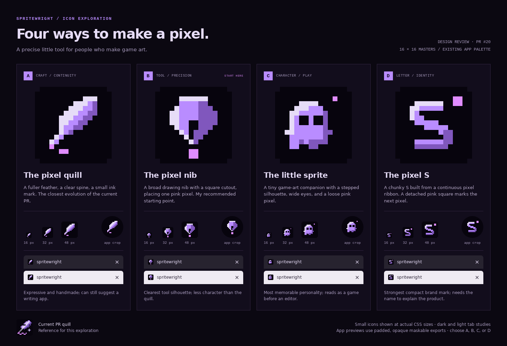

# Spritewright icon proposals

Four alternatives for PR #20, ready for choosing a direction and iterating.



Spritewright is a browser-based pixel-art editor for game assets. Its precise tools, sprite animation, lossless PNG editing and GitHub handoff suggest a small artist's workbench. These designs retain the editor's purple, pink and near-black palette and use hand-authored pixels so the favicon is the source of the design, rather than a downscaled illustration.

| Option | Idea | Strength | Tradeoff |
| --- | --- | --- | --- |
| A — Pixel quill | Simplify the existing quill into a fuller feather and a small ink mark. | Craft, authorship, continuity with the PR. | Can suggest writing rather than drawing. |
| B — Pixel nib | A drawing nib with a square cutout, depositing a pink pixel. | Clear tool silhouette and a direct pixel-making gesture. Recommended starting point. | More conventional; less personality than A or C. |
| C — Little sprite | A small game-art companion with one loose pixel. | Friendly, memorable, potential for future animation. | Could be mistaken for a game icon. |
| D — Pixel S | An angular ribbon forms the initial, with a detached pink square. | Compact identity that remains legible when small. | The name must establish its connection to an editor. |

Open `index.html` locally to see 16, 32 and 48 px exports at their actual CSS sizes, on light and dark browser-tab studies. The circle is an illustrative crop of the opaque maskable export, not an installed-device screenshot. View the comparison image at full resolution to judge small sizes; GitHub may scale it to fit the page.

## Editing and regeneration

`generate.mjs` contains the four editable 16×16 pixel matrices and palette. It writes an SVG master, PNGs at 16/32/48/192/512 px, an opaque 512 px maskable study, and the review HTML for each option. The generator uses the repository's existing PNG encoder, with no new dependencies.

```sh
node docs/pr-logo/proposals/generate.mjs
```

Every normal export uses integer nearest-neighbour scaling. Maskable studies place the 16×16 master at 24 px per source pixel with a 64 px inset on a 512 px opaque canvas. Generation checks that all foreground pixels fit within the central circle of radius 40% of the canvas. SVGs preserve the grid using `shape-rendering="crispEdges"`.

`comparison.png` is a browser capture of `index.html` at a 1480 px viewport and device scale 1. Refresh that capture after editing the masters or HTML. The review page was checked at 390, 768 and 1480 px for image loading and horizontal overflow.

These assets are proposals under `docs/`. The existing PR's quill remains the wired favicon and app icon until a direction is chosen. After selection, refine that master and regenerate the production favicon, regular app icons, Apple touch icon and maskable icon together.
