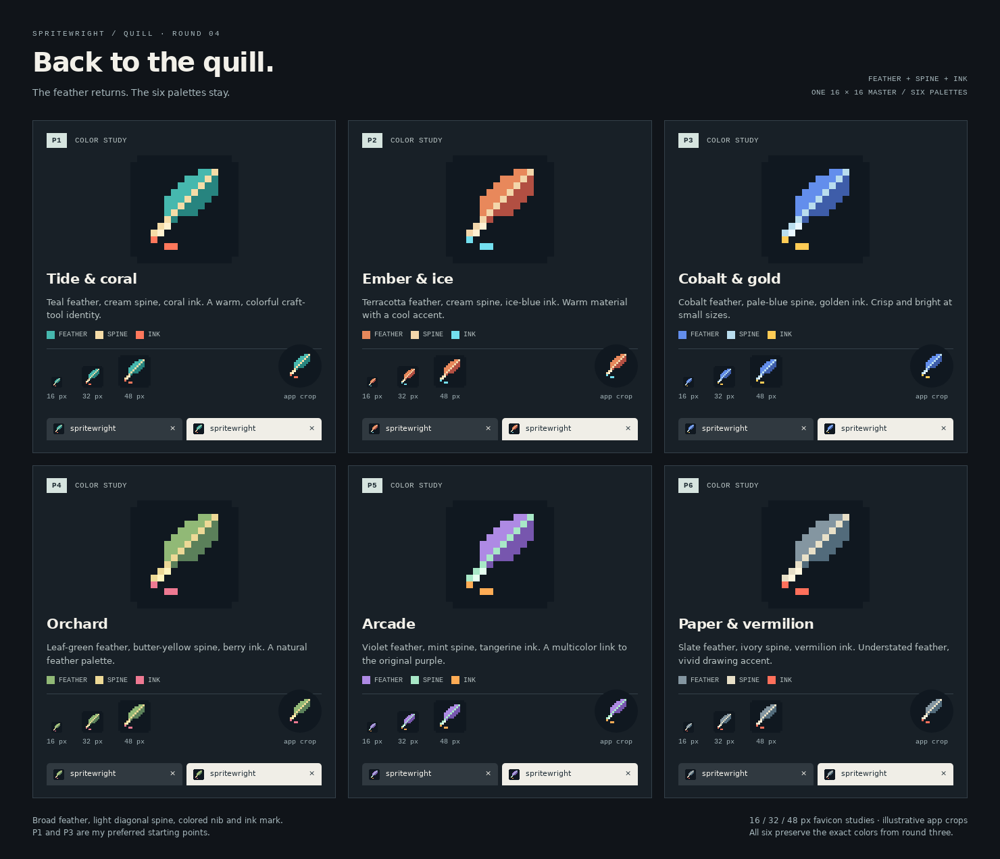

# Round 4: return to the quill, retain the palettes

The quill is the current direction. This round restores the broad feather silhouette from round one's option A and transfers the six color palettes from round three without changing their color values.



The light diagonal spine separates the feather's two vanes. A small colored nib and ink mark connect the feather to drawing. All six options use the same hand-authored 16×16 geometry.

| Palette | Feather | Spine | Nib and ink |
| --- | --- | --- | --- |
| P1 — Tide & coral | Teal | Cream | Coral |
| P2 — Ember & ice | Terracotta | Cream | Ice blue |
| P3 — Cobalt & gold | Cobalt | Pale blue | Gold |
| P4 — Orchard | Leaf green | Butter yellow | Berry |
| P5 — Arcade | Violet | Mint | Tangerine |
| P6 — Paper & vermilion | Slate | Ivory | Vermilion |

**Recommendation: P1**, with P3 as the crisper alternative. Pick a palette to refine on the quill.

## Source and review

`designs.mjs` stores the quill matrix and imports the exact palette definitions from round three. The former body colors now color the feather and its shade; the former face colors define the spine and shaft highlight; the accent colors the nib and ink mark.

```sh
node docs/pr-logo/proposals/round-4/generate.mjs
```

The generator writes six SVGs, 36 PNGs, and `index.html`. Each palette includes 16/32/48/192/512 px exports and a padded, opaque 512 px maskable study. Open `index.html` locally to see native-size icons, light/dark tab studies, and illustrative circular app crops. `comparison.png` is a browser capture at 1480 px width and device scale 1; refresh it after changes. View it at full resolution to assess small sizes.

Validation covers all PNG dimensions, exact integer scaling, opaque maskable backgrounds, matching geometry across palettes, and preservation of the round-one quill silhouette. The generator checks every maskable foreground pixel against the central 40%-radius safe circle. The review page loads all images and fits 390, 768 and 1480 px viewports without horizontal overflow.

Production icons still contain the PR's initial purple quill. These are color proposals; after choosing a palette, update the inline favicon, regular app icons, Apple touch icon and maskable icon together.
