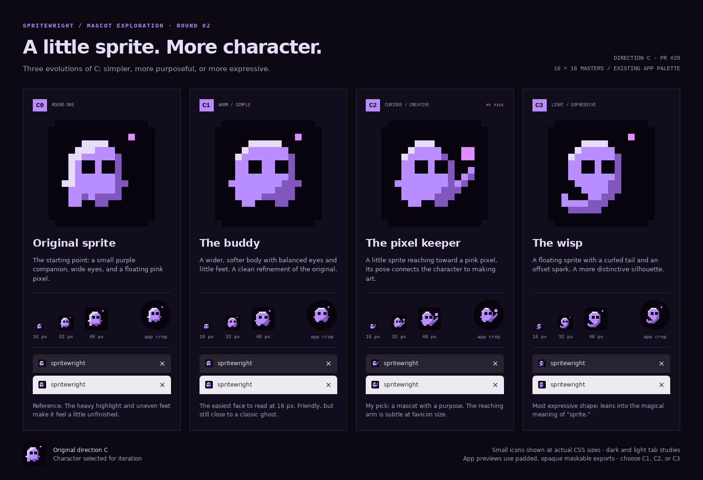

# Round 2: develop the little sprite

Direction C is the starting point for this round. Preserve the purple body, dark square eyes, pink pixel and handmade 16×16 construction; explore the character's silhouette and purpose.



| Option | Change | Why choose it | Tradeoff |
| --- | --- | --- | --- |
| C0 — Original | Unchanged round-one reference. | Compare the refinements against the character that prompted this round. | Heavy highlight and uneven feet. |
| C1 — Buddy | Wider body, restrained highlight, balanced eyes and short feet. | The simplest, friendliest favicon. | Resembles a conventional ghost mascot. |
| C2 — Pixel keeper | Raises one arm toward a larger pink pixel. | Recommended: the sprite has a small creative gesture that relates to the editor. | The arm is subtle at 16 px. |
| C3 — Wisp | Floating body tapering into a curled tail. | Most distinctive silhouette; emphasizes the magical meaning of sprite. | Less directly connected to drawing. |

Choose C1, C2 or C3 as the next master to refine. C2's raised arm can also be combined with C1's rounder body.

## Files and reproduction

`designs.mjs` contains the editable pixel matrices and design notes. `generate.mjs` writes the SVG masters, PNG exports at 16/32/48/192/512 px, opaque 512 px maskable studies, and `index.html`.

```sh
node pages/icon/round-2/generate.mjs
```

Open `index.html` locally for actual-size favicon studies, dark/light tab mockups and circular app crops. `comparison.png` is a browser screenshot at 1480 px width and device scale 1; refresh it after regeneration. GitHub may shrink the board, so open the image at full resolution to assess small icons.

The same four-color palette, integer nearest-neighbour scaling and maskable safe-area check from round one apply. Every foreground pixel in a maskable study fits inside the central circle with radius 40% of the canvas width. Preview layouts were checked at 390, 768 and 1480 px. All 24 exports decode at expected sizes, their integer-scaled pixels match the source, maskable backgrounds are opaque, and C0 matches the original C pixel for pixel.

The production favicon and app icons remain the PR's original quill while these variants are reviewed. Once a mascot variant is chosen, update all production formats from that master together.
