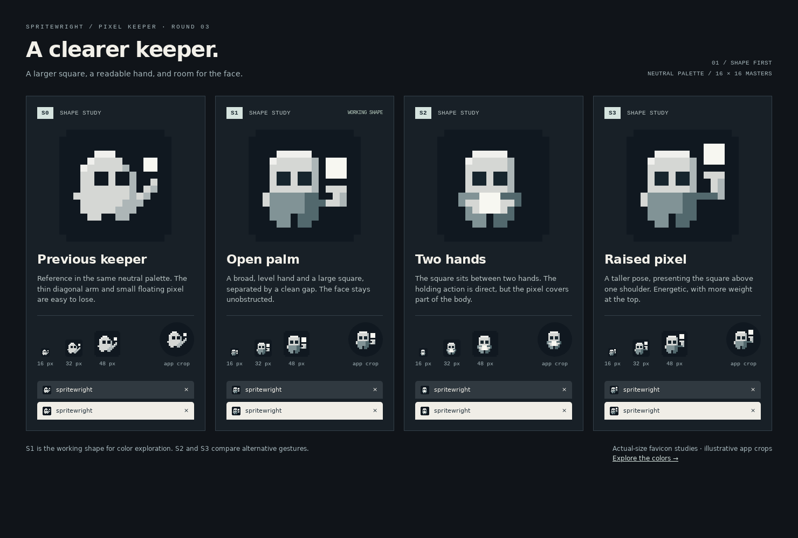
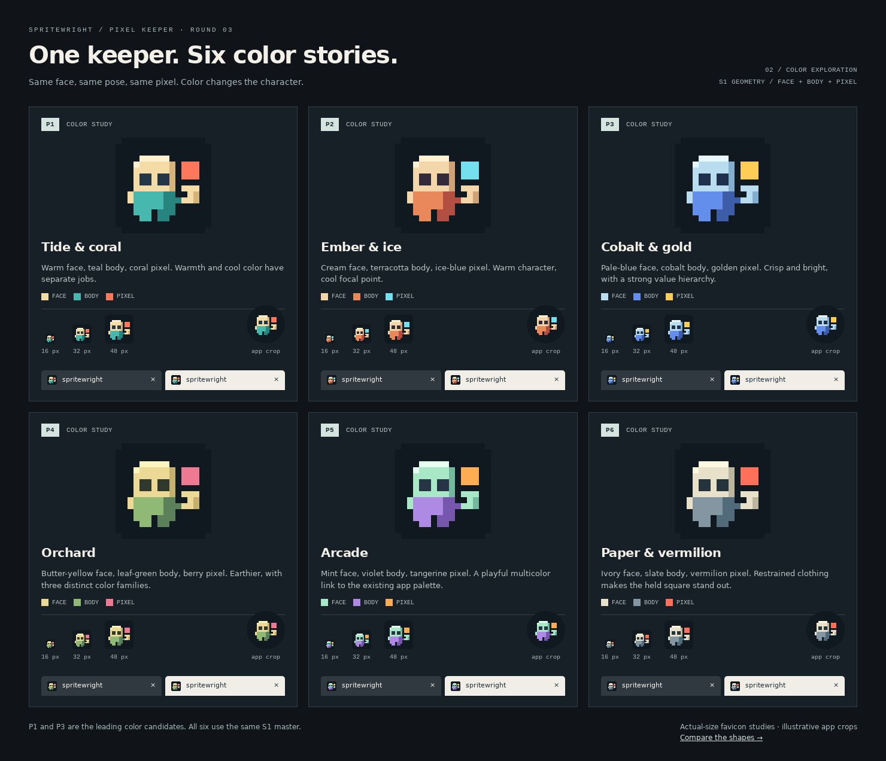

# Round 3: clearer Pixel keeper, then color

The Pixel keeper is the chosen direction. This round first studies the holding gesture in a shared neutral palette, then explores six color schemes on the same working shape. Purple is optional.

## 1. Shape



| Shape | Change | Assessment |
| --- | --- | --- |
| S0 — Previous keeper | Round-two geometry recolored into the neutral palette for reference. | Thin diagonal arm and small floating square are easy to lose. |
| S1 — Open palm | A broad horizontal palm, connected forearm, and 3×3 square with one clear row of space above the hand. | Recommended working shape: the face stays visible and the pixel reads as the object being presented. |
| S2 — Two hands | Both hands flank a square at chest height. | Most direct holding gesture, but the square covers much of the body. |
| S3 — Raised pixel | Longer raised forearm places the pixel above one shoulder. | More energetic, with a taller and more top-heavy silhouette. |

The new shapes use a cleaner head, contained square eyes, shorter feet and distinct face/body regions. Each remains a hand-authored 16×16 sprite, with no extra facial detail that disappears in a favicon.

## 2. Color



All six palettes use **S1's identical pixel matrix**. Face, body and held pixel have separate color roles. A common neutral ink tile (`#101820`) avoids tying the comparison to the app's purple interface.

| Palette | Face | Body | Pixel | Character |
| --- | --- | --- | --- | --- |
| P1 — Tide & coral | Warm cream | Teal | Coral | Friendly and balanced; my first choice. |
| P2 — Ember & ice | Cream | Terracotta | Ice blue | Warm character with a cool focal point. |
| P3 — Cobalt & gold | Pale blue | Cobalt | Gold | Crisp, bright; my second choice. |
| P4 — Orchard | Butter yellow | Leaf green | Berry | Earthier, with three distinct color families. |
| P5 — Arcade | Mint | Violet | Tangerine | Playful multicolor connection to the existing purple identity. |
| P6 — Paper & vermilion | Ivory | Slate | Vermilion | Restrained body with a strongly accented pixel. |

Pick a shape and palette, for example **S1 + P1**. The color roles also transfer to S2 or S3; using S1 for this board is a working recommendation, not a final selection.

## Reproduction and review

`designs.mjs` holds three shape matrices, the neutral palette, and six named palettes. `generate.mjs` imports the previous keeper for S0 and writes 10 SVGs, 60 PNGs, and two linked review pages:

```sh
node pages/icon/round-3/generate.mjs
```

- Open `index.html` for shapes and `colors.html` for colors. Both show 16/32/48 px icons at actual CSS size, light/dark browser tabs, and illustrative circular app crops.
- PNG exports: 16/32/48/192/512 px, plus an opaque 512 px maskable study per design. All scaling uses whole source-pixel multiples.
- `shapes.png` and `colors.png` are browser captures at a 1480 px viewport and device scale 1. Refresh them after regeneration. Open the images at full resolution to assess native sizes; GitHub may shrink them.
- Validation: all 60 exports decode at expected dimensions; normal exports match the source pixel for pixel at their integer scales; maskable backgrounds are opaque and foreground fits the central 40%-radius circle. All six palettes share one source geometry, including matching eye, hand, and pixel positions.
- Both review pages load all images and fit 390, 768 and 1480 px viewports without horizontal overflow.

These remain review assets. After a shape and palette are selected, update the production favicon, app icons, Apple touch icon and maskable icon together.
