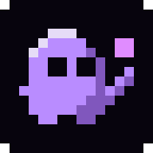
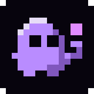
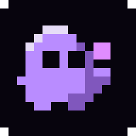

# Refine our pixel keeper

Keep C2's face, body, feet and purple/pink colors. Focus on a more readable gesture before revisiting palettes.

| C2 — Original | C2a — Clearer palm | C2b — Closer pixel |
| --- | --- | --- |
|  |  |  |
| The starting point. | Recommended: only four changed pixels, a wider palm and tidier wrist. | A compact gesture with the pixel closer to his cheek. |

Open `index.html` for native 16/32/48 px sizes, light/dark browser tabs and circular app crops.

Edit the `*-16.png` files in Spritewright for hands-on iteration. `designs.mjs` currently defines the generated masters; running `node pages/icon/round-5/generate.mjs` replaces PNG edits, so transfer chosen edits into the matrix before regenerating. The generator exports PNGs at 16/32/48/192/512 px, SVGs and opaque maskable studies.

The animated favicon prototype has been removed. These are static mascot proposals; the favicon uses the static A-quill until a mascot refinement is selected.
