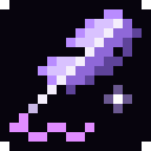
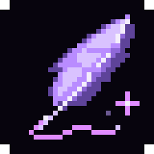
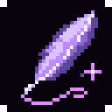
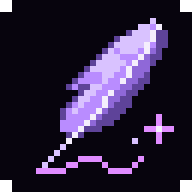

# Detailed quills at 32 × 32

Start from the detailed quill in `pages/icons/icon-512.png`: its feather notches, bright spine, pink ink flourish and sparkle are the character to preserve. The three new masters use four times as many pixels as the original 16 × 16 grid.

| Current icon | Q1 — The scribe | Q2 — The flourish | Q3 — The enchanted quill |
| --- | --- | --- | --- |
|  |  |  |  |
| Original artwork, doubled to 32 px without changing its pixels. | Recommended: layered barbs, a bright spine and a restrained ink flourish. | A curved plume and looping ink stroke. | A more jagged feather with brighter facets and a zigzag stroke. |

Open `index.html` for 16/32/64 px studies, app crops and light/dark tab previews. The 16 px exports are nearest-neighbor reductions for comparison; a selected design should receive a dedicated 16 px simplification before adoption.

## Edit in Spritewright

Edit `pages/icon/round-6/*-32.png` directly. **These PNGs are the masters.** Run:

```sh
node pages/icon/round-6/generate.mjs
```

This reads your edited masters and regenerates 16/64/192/512 px PNGs, opaque maskable exports and the HTML review. It never rewrites the 32 px masters. `create-masters.mjs` records the original pixel construction recipes and only creates masters that are missing.

The original detailed quill remains the production favicon and app icon while these proposals are reviewed. Violet, lavender and pink are held constant so the new feather shapes can be compared directly.
